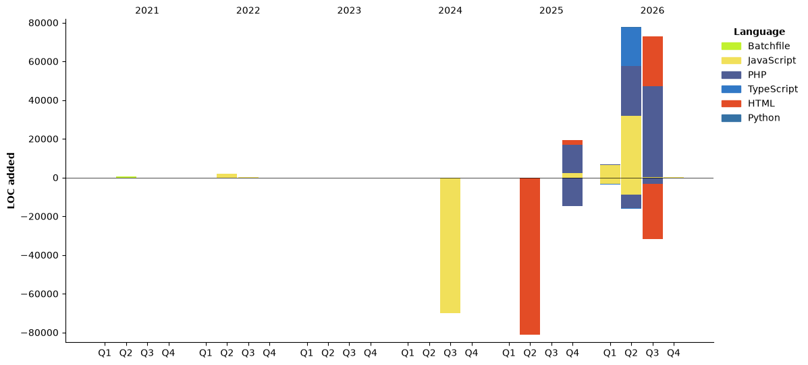

# ✌ Yop, I'm 4samsamAC!

I try hard the learning Zig, :O And when I don't code, I try hard osu! Or I sleep like a mimir ;-;

<!--START_SECTION:waka-->


**🐱 My GitHub Data** 

> 📦 348.9 kB Used in GitHub's Storage 
 > 
> 🏆 385 Contributions in the Year 2026
 > 
> 🚫 Not Opted to Hire
 > 
> 📜 9 Public Repositories 
 > 
> 🔑 29 Private Repositories 
 > 
**I'm an Early 🐤** 

```text
🌞 Morning                279 commits         ███████░░░░░░░░░░░░░░░░░░   29.81 % 
🌆 Daytime                277 commits         ███████░░░░░░░░░░░░░░░░░░   29.59 % 
🌃 Evening                182 commits         █████░░░░░░░░░░░░░░░░░░░░   19.44 % 
🌙 Night                  198 commits         █████░░░░░░░░░░░░░░░░░░░░   21.15 % 
```
📅 **I'm Most Productive on Friday** 

```text
Monday                   166 commits         ████░░░░░░░░░░░░░░░░░░░░░   17.74 % 
Tuesday                  103 commits         ███░░░░░░░░░░░░░░░░░░░░░░   11.00 % 
Wednesday                115 commits         ███░░░░░░░░░░░░░░░░░░░░░░   12.29 % 
Thursday                 179 commits         █████░░░░░░░░░░░░░░░░░░░░   19.12 % 
Friday                   276 commits         ███████░░░░░░░░░░░░░░░░░░   29.49 % 
Saturday                 40 commits          █░░░░░░░░░░░░░░░░░░░░░░░░   04.27 % 
Sunday                   57 commits          ██░░░░░░░░░░░░░░░░░░░░░░░   06.09 % 
```


📊 **This Week I Spent My Time On** 

```text
🕑︎ Time Zone: Europe/Paris

💬 Programming Languages: 
JavaScript               53 mins             ██████████░░░░░░░░░░░░░░░   41.27 % 
Other                    39 mins             ████████░░░░░░░░░░░░░░░░░   30.81 % 
HTML                     34 mins             ███████░░░░░░░░░░░░░░░░░░   26.48 % 
JSON                     0 secs              ░░░░░░░░░░░░░░░░░░░░░░░░░   00.49 % 
Text                     0 secs              ░░░░░░░░░░░░░░░░░░░░░░░░░   00.44 % 

🔥 Editors: 
VS Code                  2 hrs 9 mins        █████████████████████████   100.00 % 

🐱‍💻 Projects: 
idee stream aov          2 hrs 9 mins        █████████████████████████   99.82 % 
ChoukyBotDiscordPrive    0 secs              ░░░░░░░░░░░░░░░░░░░░░░░░░   00.18 % 

💻 Operating System: 
Windows                  2 hrs 9 mins        █████████████████████████   100.00 % 
```

🤖 **AI Coding This Week** 

```text
No AI Coding Activity Tracked This Week
```

**I Mostly Code in JavaScript** 

```text
JavaScript               18 repos            █████████░░░░░░░░░░░░░░░░   37.50 % 
PHP                      15 repos            ████████░░░░░░░░░░░░░░░░░   31.25 % 
HTML                     7 repos             ████░░░░░░░░░░░░░░░░░░░░░   14.58 % 
TypeScript               3 repos             ██░░░░░░░░░░░░░░░░░░░░░░░   06.25 % 
Python                   2 repos             █░░░░░░░░░░░░░░░░░░░░░░░░   04.17 % 
```


**Timeline**




 Last Updated on 01/11/2026 12:37:21 UTC
<!--END_SECTION:waka-->

<!-- [](https://github.com/ashutosh00710/github-readme-activity-graph) -->
If you're looking for me, I'm mostly on Discord. Soooo don't hesitate to ping me (Btw send me a message demand, and don't forget http://nohello.com/ ⁣I don't accept other ways.) : 
<a href="discord://-/users/581625633830993961"></a>
